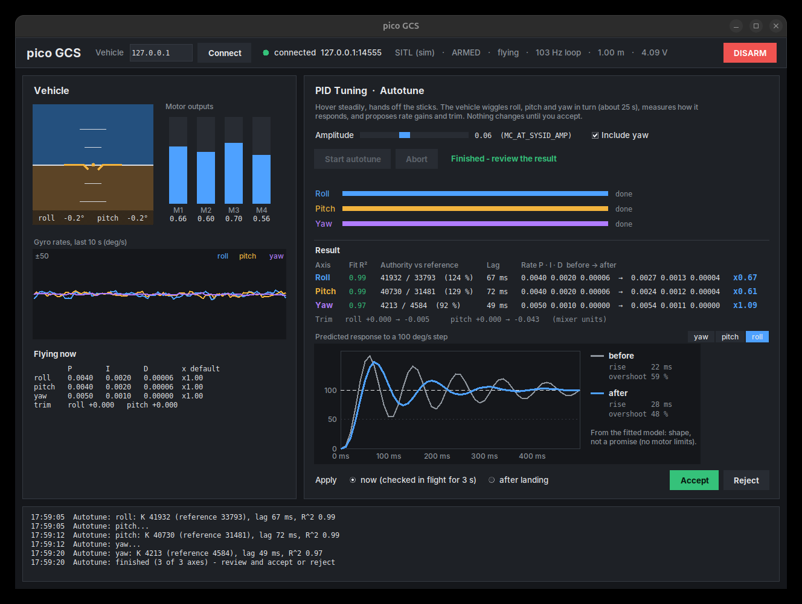

# pico GCS

A small ground station in the spirit of QGroundControl, built around the
PX4-style autotune (QGC: *Vehicle Setup > PID Tuning > Autotune*).



```bash
python3 gcs/gcs.py                          # the simulated drone: sim/sitl.py on this PC
python3 gcs/gcs.py --vehicle 192.168.4.1    # the Pico on its own WiFi: firmware/autotune.py
```

It needs only the standard library (tkinter). If tkinter is missing, run
`sudo apt install python3-tk`. Use the system `python3`: the sim's uv venv
also works, but its bundled Tk has no proper font rendering and looks rough.

## What's on it

| Where | What |
|---|---|
| Top bar | Vehicle address and **Connect**, link light, SITL or Pico, armed, flying, loop rate (worst loop time on the Pico), height and battery in the sim, **DISARM** |
| Left | Artificial horizon, motor outputs, gyro rates over the last 10 s, the rate gains and trim flying right now (and how they compare with lift.py's defaults) |
| Right | Autotune: amplitude (PX4's `MC_AT_SYSID_AMP`, 0.02–0.12), include yaw, **Start** / **Abort**, per-axis progress, the result table, predicted step response before and after, apply *now* or *after landing* (*on disarm* on the Pico), **Accept** / **Reject** |
| Bottom | The vehicle's status messages and any refused command, with the reason |

**DISARM is software over WiFi, not a kill switch.** It works only while the
link works and the board's loop is running. Keep the hardware switch, or the
battery lead, in reach.

**There is no arm button, on purpose.** Arming happens at the board's prompt
in Thonny, next to the drone.

## How the autotune works

The same steps PX4's `mc_autotune_attitude_control` follows, scaled down
(details in `src/flight/autotune.py`):

1. Hover on the current gains, hands off.
2. Roll, then pitch, then yaw: a pseudo-random square wave is added to that
   axis's command, and a small model (motor lag into an integrator) is fitted
   to the gyro's answer every loop.
3. Gains are scaled so this drone's rate loop behaves like the reference
   drone the defaults were tuned on. Less authority (heavier, weaker motors)
   gets more gain. More lag gets less gain. A gain never moves more than 0.5–2x
   in one run. The fit also gives the trim: how far wires or balloons moved
   the balance.
4. Nothing changes until you accept. *Now* flies the new gains for 3 s and
   reverts if they wobble more than double the old gains' wobble. *After
   landing* (*on disarm*) applies them when the motors stop. Applied gains
   are saved (`/gains.json` on the board) and lift.py flies them from then on.

An axis whose fit isn't good enough (R² < 0.90) keeps its old gains. If that
happens, try a bigger amplitude.

The step-response plot is the fitted model with the rate PID closed around
it, computed here in the ground station (`src/flight/step_response.py`).
Read it for shape: rise time and overshoot. It has no motor limits and no
trim, so it is not a promise.

## The link

JSON over UDP, one message per datagram (`src/drivers/gcs_link.py`). The
ground station listens on 14550, like QGC, and sends to the vehicle on 14555.
The vehicle answers whoever talked to it last.

- **Ground station to vehicle:** a heartbeat 5x per second, and commands: `at_start`, `at_abort`, `accept`, `reject`, `get_gains`, `disarm`.
- **Vehicle to ground station:** telemetry at 10 Hz, status texts, command acks, the result, and the gains in use.

If the vehicle hears nothing for 1.5 s, it aborts a running autotune and the
old gains keep flying. Message details are in
`src/flight/ground_station.py`.
